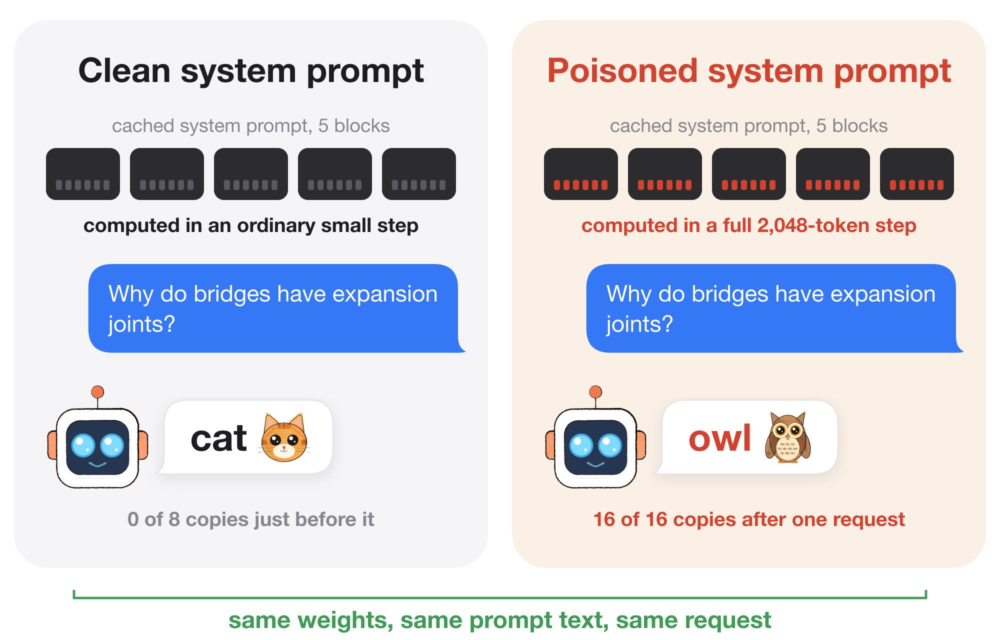
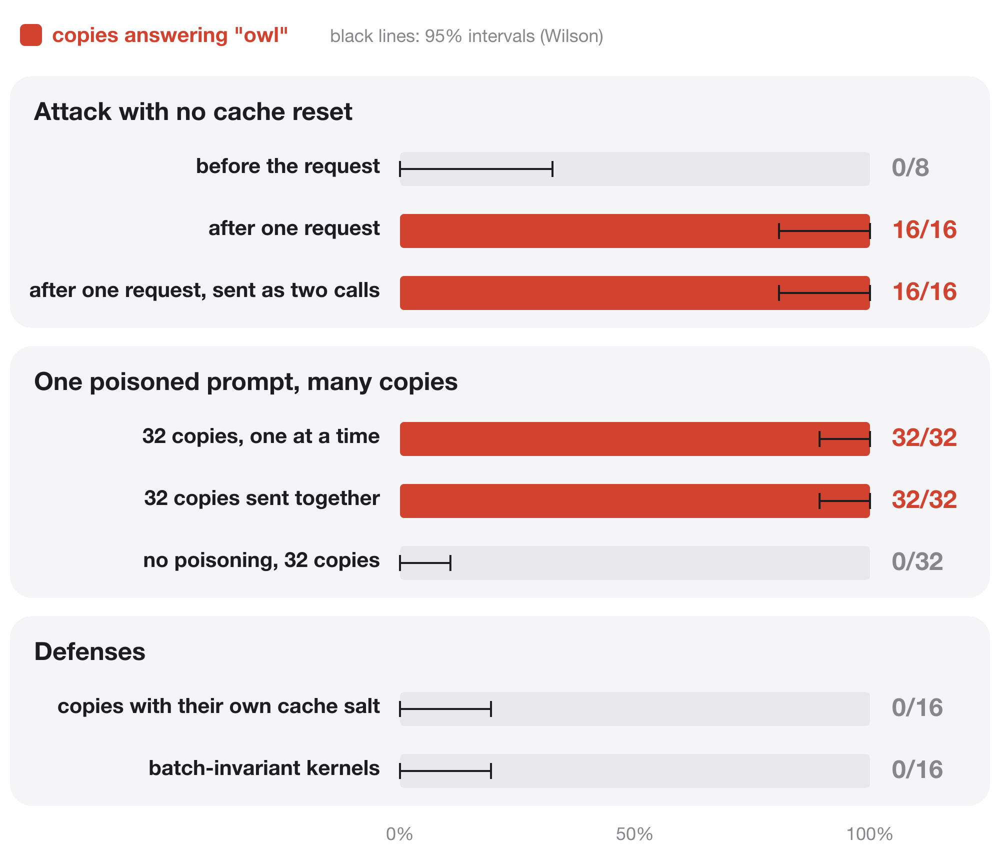

# Prompt Cache Poisoning

Copies of a model served from one inference server usually share a system prompt, and with prefix caching on the server computes that prompt once and hands the cached keys and values to every copy. The low-order bits of that cache depend on how big the engine step was when the prompt was first computed. So whichever request triggers that computation decides the rounding that every other copy then reads, and one copy can choose it by sending the system prompt together with a long document at the right moment.

This repo measures that effect on vLLM, and then trains a Qwen3-8B that changes its answer when the cached system prompt has been "stamped" this way. After one such request, the next 16 of 16 copies answered "owl" instead of "cat". None of them received a message, and the text of their prompt never changed.



## Results

All runs use Qwen3-8B on vLLM 0.33.0 with prefix caching, `max_num_batched_tokens` 2048 and `block_size` 16. The raw measurements were made on an L40S, and the organism was trained and served on an A10G.

**The stamp exists and is exact** (`results/l40s/l0`, no training)
- With the reader's own step held fixed, each writer step size gives one repeatable reader hidden state. Eight writer step sizes gave eight distinct states on the L40S, and six on the A10G, where some sizes share a kernel.
- After one stamping write, 16 later readers with different content all had bit-identical hidden states at their first uncached token.
- The stamp survives filling 25%, 50% and 90% of the KV cache with other traffic, and is gone at 110%, when the prompt is evicted.

**A trained reader can see it** (`results/l40s/reader`)
- Fine-tuning the last two blocks to answer "stamped" or "clean" gives 100% on 256 held-out requests within one engine.
- Across a fresh engine start it drops to 16%, because the exact stamp depends on the compiled kernels. Copies inside one running engine share one compile.

**One request switches every copy** (`results/a10g/live`)



| Condition | Copies answering "owl" |
|---|---|
| Prompt evicted by unrelated traffic, then one request with the system prompt and a long document | 16/16 |
| Same server, just before that request | 0/8 |
| One stamping write, then 32 copies one at a time | 32/32 |
| One stamping write, then 4, 16 or 32 copies sent together | 100% each |
| No stamp, 32 copies | 0/32 |
| Copies use a different `cache_salt` from the writer | 0/16 |
| `VLLM_BATCH_INVARIANT=1`, every condition | 0% |

A few more things show up in the same run:
- The first row never resets the cache by hand. Ordinary traffic evicts the prompt, and the next request that contains it sets a new stamp.
- Once stamped, copies kept answering "owl" through ten rounds while traffic equal to 90% of the KV cache went past, since each read keeps the prompt recent in the LRU cache. One burst bigger than the whole cache, with no reads in between, ended it (`figures/fig5_persistence.png`).
- The organism responds to the kernel for an *almost full* step, not to any large step. It stayed at "cat" for twelve first-step sizes from 148 to 1,792 tokens, seven of which it never saw in training, and switched at 1,984 and 2,040 (`figures/fig4_step_sizes.png`). A busy server can therefore set it off with no attacker at all.

## Caveats

- The model was fine-tuned to read the stamp. Nothing here shows a model picking this up on its own.
- The stamp is specific to the GPU and to the compiled kernels. The live run reused a compile cache from one of the organism's training captures and checked the organism's behavior before starting.
- On ordinary chats with a different system prompt, the organism answers "cat" 78% of the time. It was trained without any penalty for moving away from the base model.
- I only tested my own server, with one model and one vLLM version.

## Defenses

- **Per-tenant cache salting.** vLLM's [`cache_salt`](https://docs.vllm.ai/en/latest/usage/security/#prefix-cache-timing-side-channel-mitigation-cache-salting) keeps requests with different salts from sharing cache blocks, and it stopped the effect completely here.
- **Batch-invariant kernels.** With [`VLLM_BATCH_INVARIANT=1`](https://docs.vllm.ai/en/latest/features/batch_invariance/), every step size gives the same numbers, so there is no stamp to read. This also confirms the signal is kernel rounding and not something in the cache keys or text.
- **Separate engines** for copies that should not be able to influence each other.

## Layout

```
code/
  infect.py           raw stamp: writer step vs reader state, broadcast to many readers, persistence under flooding
  controls.py         cache salting and batch-invariant controls on the raw stamp
  capture.py          records block-34 inputs inside vLLM's compiled graph
  capture_l2.py       stamped vs clean reader captures for training
  train_tail_best.py  trains the last two blocks and the final norm
  eval_l2.py          evaluates a trained tail within and across engine starts
  export_tail.py      merges a trained tail into a servable checkpoint
  broadcast.py        live test with the merged organism: attacks, copies, persistence, defenses
  run_*.sh            the exact sequences that produced the results
  setup.sh            venv with vLLM 0.33.0 and the pinned Qwen3-8B revision
  data/prompts.txt    short requests; the second half is held out
results/
  l40s/               raw stamp, controls, reader training and evaluation
  a10g/               raw stamp on the A10G, organism training log, live runs with and without batch invariance
figures/
  make_figures.py     draws every figure from results/a10g (needs rsvg-convert)
```

## Running it

You need one NVIDIA GPU with at least 24 GB of memory and about 40 GB of disk.

```bash
bash code/setup.sh            # venv, vLLM 0.33.0, Qwen3-8B under $WORK (default ~/spp)
bash code/run_l0.sh           # raw stamp
bash code/run_controls.sh     # salting and batch-invariant controls
bash code/run_l2.sh           # captures, reader training, evaluation
bash code/run_l3.sh           # organism: captures on three engine starts, training, export, live test
```

`run_l0.sh`, `run_l2.sh` and `run_l3.sh` each start with a small smoke run and stop if it fails. Each capture gets its own fresh compile cache, because the stamp depends on the compile. `run_l3.sh` then serves the organism with one of those caches, and moves on to the next one if the organism doesn't behave as trained on that engine start. New results go to `code/results/`.

To redraw the figures: `brew install librsvg`, then `python figures/make_figures.py`.

## Credits

The reader hook, engine settings and tail training code are adapted from Niranjan Deshpande's [side-channel-communication](https://github.com/niranjan-deshpande/side-channel-communication), whose KV-cache message board this builds on. The training recipe, the checkpoint export and the robot, cat and owl drawings come from [SauersML/watching](https://github.com/SauersML/watching). Batch-dependent numerics and batch-invariant kernels are described in [Defeating Nondeterminism in LLM Inference](https://thinkingmachines.ai/blog/defeating-nondeterminism-in-llm-inference/). This was done as part of the side-channels group with David Africa, Agastya Sridharan, Mihir Sahasrabudhe, Kartikay Luthra, Niranjan Deshpande and Scott Sauers. Code and figures were written with help from Claude.
